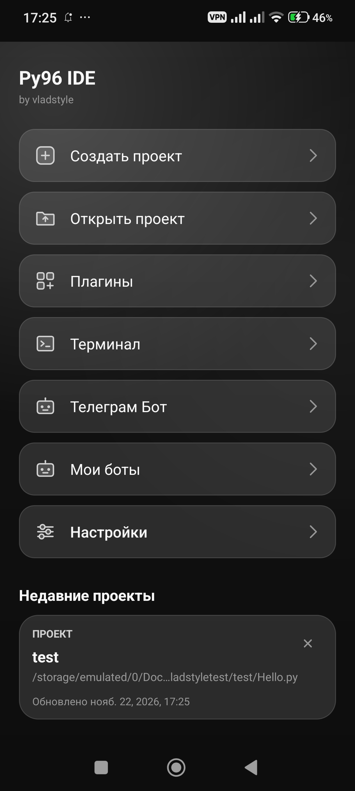
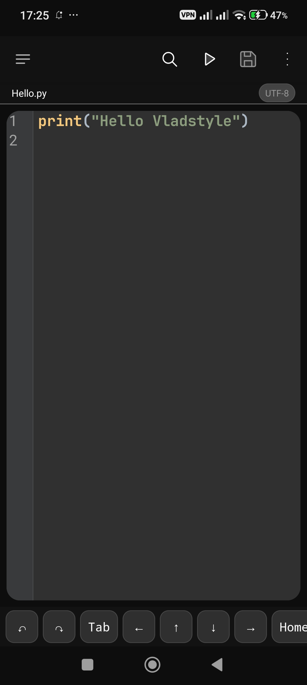
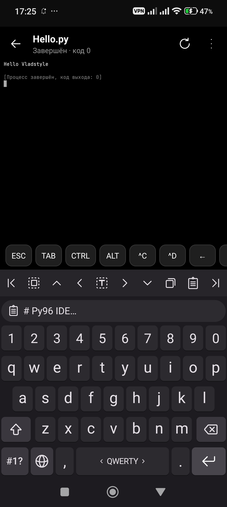
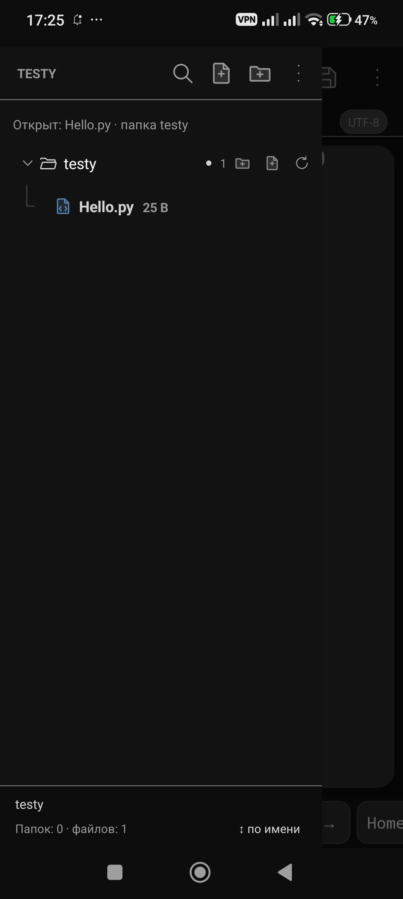
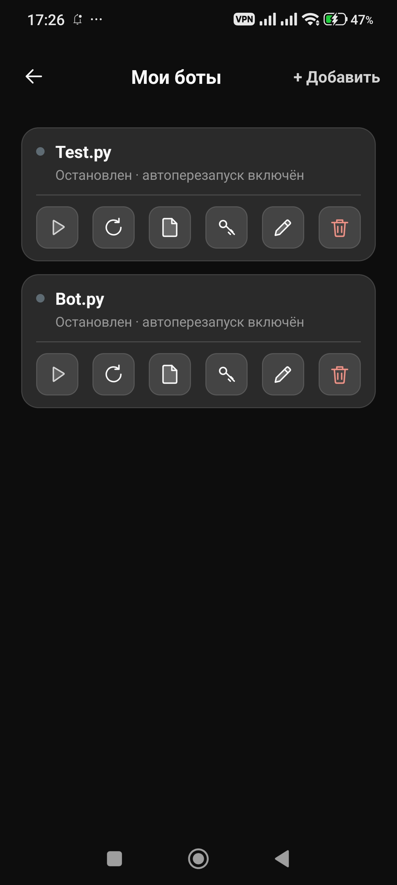
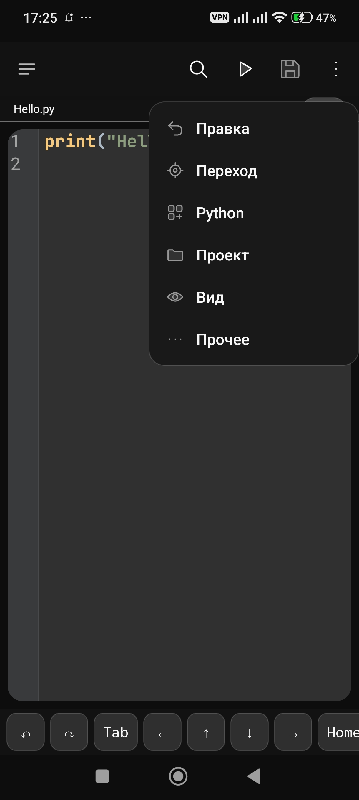
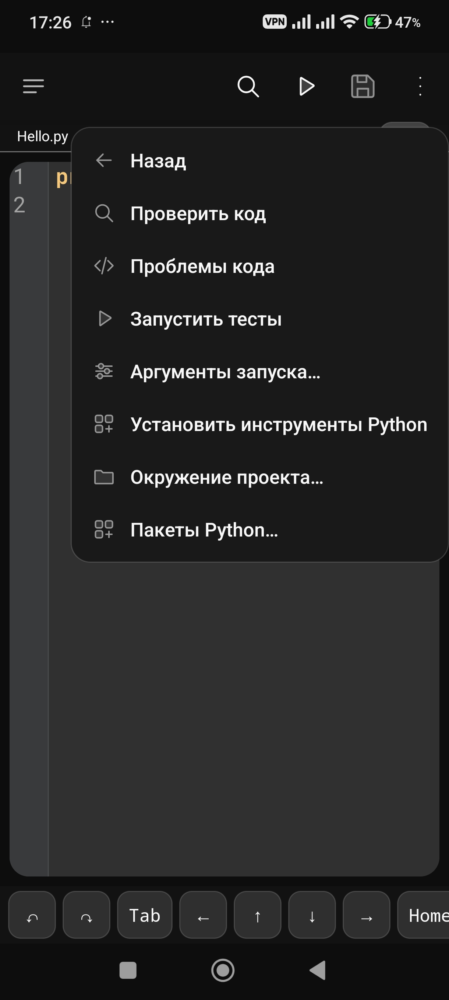
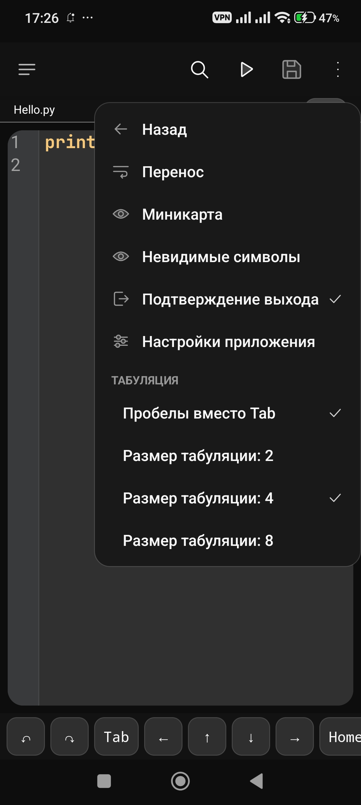

# Py96 IDE

Мобильная среда разработки на Python для Android. Пишите, запускайте и отлаживайте Python-скрипты, Telegram-ботов и простые графические программы прямо на телефоне или планшете.

**Версия:** 2.1 · **Минимальная версия Android:** 8.1 (API 27) · **Автор:** [vladstyle](https://t.me/vladstyle1337)

---

## Возможности

- **Редактор кода** с подсветкой синтаксиса Python и других языков, поиском и заменой, навигацией по символам и отменой/повтором действий.
- **Автодополнение и подсказки** на основе Jedi.
- **Проверка кода** (линтер) с подсветкой ошибок и предупреждений прямо в тексте.
- **Файловый менеджер и дерево проекта**: создание, переименование, удаление файлов и папок, быстрый переход к файлу.
- **Поиск по проекту** по тексту и по символам.
- **Встроенный терминал** с полноценной оболочкой Bash.
- **Запуск программ** в один нажатие, включая запуск в фоне с отдельным сервисом.
- **Виртуальные окружения (venv)** и менеджер пакетов pip.
- **Git-панель**: статус, просмотр изменений, коммиты и работа с ветками.
- **Точки останова** для отладки.
- **Графические окна tkinter**: встроенный X-сервер открывает их внутри приложения.
- **Конструктор Telegram-ботов**: создание шаблона проекта с `.env` для токена, запуск и просмотр лога бота. Токены хранятся в зашифрованном виде через Android Keystore.
- **Плагины**: Python, оболочка, git, компилятор и другие инструменты устанавливаются одной кнопкой из репозитория Termux.
- **Темы оформления**, настройки редактора и восстановление несохранённых изменений после сбоя.

## Установка

1. Скачайте последний APK-файл со страницы [Releases](../../releases).
2. Откройте файл на телефоне. Если система попросит, разрешите установку из неизвестных источников для вашего браузера или файлового менеджера.
3. Запустите **Py96 IDE** и при первом запуске пройдите короткое приветствие.
4. Откройте раздел **Плагины** и установите плагин **Python**. Для работы редактора нужен Python, поэтому без этого шага скрипты не запустятся.

Для установки плагинов нужен интернет. Пакеты загружаются из официального репозитория [Termux](https://termux.dev).

## Скриншоты

  
  
  

  
  
  

  
  

## Требования

- Android 8.1 или новее (API 27+).
- Около 300 МБ свободного места для Python и инструментов. Точный размер зависит от выбранных плагинов.
- Интернет для установки плагинов, pip-пакетов и работы ботов.

## Важные замечания

- Приложение работает с файлами во внешнем хранилище, поэтому при первом открытии проекта потребуется разрешение на доступ к файлам.
- Плагин Python и пакеты из pip ставятся внутри приложения и не затрагивают системные данные.
- Для запуска программ используется `targetSdk 28`. Это осознанное решение: на более новых версиях Android запрещено выполнять программы из каталога приложения, а терминал и запуск скриптов работают именно так. Поэтому обновление приложения возможно только через сборку, которую вы скачали здесь, а не через сторонние магазины с другими требованиями.
- При восстановлении приложения из резервной копии токены ботов придётся ввести заново: ключ шифрования на устройстве не переносится.

## Обратная связь

Нашли ошибку или есть идея? Напишите в Телеграм-канал проекта: **[t.me/vladstyle1337](https://t.me/vladstyle1337)**.

## Благодарности

- [Termux](https://termux.dev): пакеты Python и утилит для плагинов.
- [Jedi](https://github.com/davidhalter/jedi): подсказки и автодополнение.
- [aiogram](https://github.com/aiogram/aiogram): библиотека для Telegram-ботов.
- Встроенный X-сервер основан на проекте с лицензией MIT.

## Лицензия

© 2026 vladstyle. Все права защищены.
Исходный код в этом репозитории не публикуется. Распространяется только собранный APK-файл.
